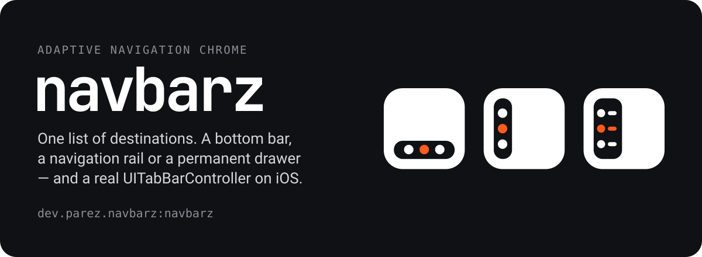
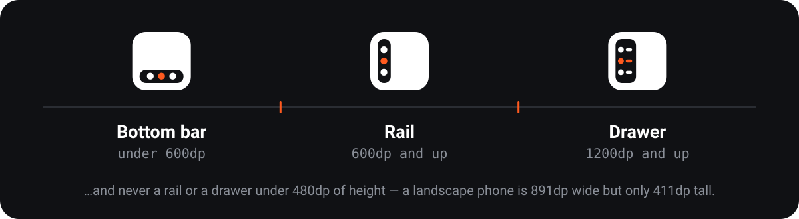

<p align="center">
  
</p>

<p align="center">
  <a href="https://central.sonatype.com/artifact/dev.parez.navbarz/navbarz"></a>
  <a href="https://github.com/jipariz/NavBarz/actions/workflows/build.yml"></a>
  
</p>

You hand NavBarz one list of destinations. It picks the chrome from the window — a bottom bar, a
navigation rail or a permanent drawer — and on iOS it hands the job to a real `UITabBarController`
instead of drawing an imitation of one.

```kotlin
implementation("dev.parez.navbarz:navbarz:0.1.0")
```

| Target | Chrome |
|---|---|
| Android | Material 3 bar / rail / drawer |
| Desktop (JVM) | same, tracking the window as you resize it |
| Web (Wasm, JS) | same, tracking the browser viewport |
| iOS | real `UITabBarController` built from Kotlin/UIKit, or a Compose-drawn bar |

## See it

Everything below is the same sample app on the same code path. Only the window changed.

| Bottom bar | Rail | Drawer |
|---|---|---|
|  |  |  |


> The sample deliberately frosts its own screens so the navigation chrome is the only thing in
> focus. That blur belongs to the demo, not the SDK — there is a switch for it in Settings.

## Why it is different

### The breakpoints are not Material's defaults

<p align="center">
  
</p>

Bottom bar under 600dp of width, navigation rail from 600dp, permanent drawer from 1200dp — and
never a rail or a drawer under 480dp of height.

Material promotes to a permanent drawer at 840dp. NavBarz waits for **1200dp**. An unfolded Pixel
10 Pro Fold is 852dp wide: under Material's default that earns a drawer eating ~40% of the screen,
under NavBarz it gets a rail and the content keeps its two panes.

| Folded — 443dp, bottom bar | Unfolded — 852dp, rail |
|---|---|
|  |  |

Both thresholds are configurable, and the height guard is why a landscape phone — 891dp wide,
411dp tall — stays on the bottom bar where it belongs.

### iOS gets the system's own chrome

`navBarzTabBarController` builds a real `UITabBarController` through Kotlin/Native's UIKit
bindings, so the **system** decides where the bar goes. On iPhone it is a Liquid Glass tab bar; on
iPad it becomes a sidebar; on iPhone Duo it relocates to the side strip by itself, in both postures.
None of that is NavBarz reacting to a size class — it is UIKit doing its job.

| iPhone | iPad — sidebar | iPhone Duo, folded | iPhone Duo, open |
|---|---|---|---|
|  |  |  |  |

It ships inside the Kotlin framework, so it is one Gradle dependency. No Swift package, no SPM step.

## Quick start

```kotlin
private val items = listOf(
    NavigationItem(title = "Home", systemIcon = "house"),
    NavigationItem(title = "Profile", systemIcon = "person", badge = "3"),
)

@Composable
fun App() {
    var selected by rememberSaveable { mutableIntStateOf(0) }
    AdaptiveNavigationScaffold(
        items = items,
        selectedIndex = selected,
        onItemSelected = { selected = it },
        icon = { index, _ ->
            Icon(if (index == 0) Icons.Filled.Home else Icons.Filled.Person, null)
        },
    ) {
        Screen(selected)
    }
}
```

That is the whole integration. `systemIcon` is the SF Symbol name the iOS chrome uses; the `icon`
slot draws everything else. Note it is a **required** parameter sitting after two defaulted ones, so
name your arguments.

## Documentation

- **[Integration guide](docs/integration.md)** — install, version catalogs, the Kotlin Toolchain,
  the four entry points, icons, breakpoint configuration, the `header` slot.
- **[iOS guide](docs/ios.md)** — the three tiers of iOS chrome, what Liquid Glass actually is and
  is not, iPad sidebar, iPhone Duo safe areas, Xcode wiring.
- **[API reference](docs/api-reference.md)** — every public declaration, with its limitations.

## The sample

`sample/` is a Pokédex on [PokéAPI](https://pokeapi.co) with three tabs, running on all five targets
from one `commonMain`. It exercises both adaptive axes at once: NavBarz picks the chrome from the
window, and *inside* the Pokemon tab a `ListDetailPaneScaffold` independently splits into two panes.

```sh
./gradlew :sample:androidApp:installDebug
./gradlew :sample:desktopApp:run                          # drag the window across 600dp and 1200dp
./gradlew :sample:webApp:wasmJsBrowserDevelopmentRun
open sample/iosApp/iosApp.xcodeproj
```

## Building this repo

```sh
./gradlew build                          # every target, the tests and the ABI check
./gradlew :navbarz:allTests              # jvm, android host, iOS simulator
./gradlew :navbarz:checkKotlinAbi        # fails if the public API changed
./gradlew :navbarz:publishToMavenLocal
./gradlew ktfmtFormat                    # ktfmt, kotlinlang style; ktfmtCheck in CI
```

`iosX64` — the Intel-Mac simulator — is not published. Apple has wound Intel Macs down and several
Compose Multiplatform artifacts have already stopped shipping that variant.

## Licence

Apache 2.0. See [LICENSE](LICENSE). Brand assets and their usage rules live in
[`assets/logo/`](assets/logo/README.md).
